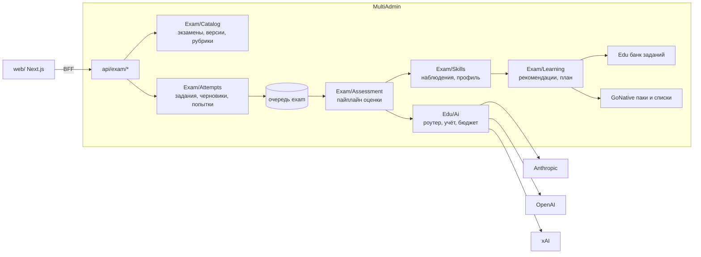

# C. Архитектура Exam Engine (черновик каркаса)

**Статус:** черновик v0 (2026-11-22). Детали оценки — в D, бенчмарк — в E, таблицы — в I.
**ТЗ:** §4, §5, §8, §10, §18, §26 C. **Основано на:** [A](A-gonative-assessment.md), [B](B-worksheets-assessment.md), ADR-001…003.

## 1. Слои ТЗ §4 → код

| Слой ТЗ | Где | Владелец данных |
|---|---|---|
| A. Общая образовательная инфраструктура | `Edu` (грамматика, упражнения, AI, переводы) + словари и списки GoNative | Edu / GoNative |
| B. Exam Engine | `Exam/Catalog`, `Exam/Attempts`, `Exam/Assessment`, `Exam/Bench` | `ex_*` |
| C. Personalized Learning Engine | `Exam/Skills`, `Exam/Learning` | `ex_*`; списки слов — в таблицах GoNative |
| D. Интерфейс | `web/` этого репо | — |



## 2. Конфигурация экзаменов

Иерархия ТЗ §5.1: Language → Provider → Exam → ExamVersion → Section → TaskType → Rubric → Criterion.
Контракт — `packages/exam-domain/src/exam-config.ts`; тесты показывают, что IELTS Academic (полосы 0–9,
взвешенное среднее Task 1 : Task 2 = 1 : 2) и Goethe B1 (баллы, сумма трёх заданий) описываются одной
моделью без кода под конкретный экзамен.

- **Хранение:** версия экзамена — неизменяемый JSON-документ в `ex_exam_versions` (с хэшем). Правка —
  новая версия. Каталог в коде (`config/exam/*.php` или JSON-сиды) → artisan-импорт с предпросмотром.
- **Статусы:** `draft` (факты не сверены) → `verified` (сверено с официальными источниками, дата)
  → `retired`. Пользователям выдаются только `verified`.
- **Версии в результатах:** попытка фиксирует `exam_version`, `rubric_version`, `pipeline_version`,
  `prompt_versions` и правило подсчёта слов (ТЗ §5.3).

## 3. Попытка и её жизненный цикл

```
draft (автосохранение) → submitted (текст заморожен, хэш, word count)
  → assessing (джоб, шаги с идемпотентностью) → assessed | partial | failed
  → (по запросу) reported (жалоба пользователя на оценку)
```

- Задание к попытке: из библиотеки (`ex_practice_tasks`, проверенные) или своё. Своё задание
  проходит проверку: соответствует ли типу задания, полнота, нет ли инструкций для модели (ТЗ §7.1 шаг 2).
- Текст ответа нормализуется (`normalizeResponse`); все офсеты считаются по нормализованному тексту
  в кодовых точках.

## 4. Пайплайн оценки (набросок, уточняется в D по итогам бенчмарка)

| # | Шаг | Детерминированный / AI |
|---|---|---|
| 1 | Проверка задания и квоты/бюджета | Д |
| 2 | Нормализация, подсчёт слов, абзацы, базовые признаки (длина, повторы) | Д |
| 3 | Загрузка рубрики версии | Д |
| 4 | Оценка по каждому критерию отдельно, structured output: находки с цитатами и диапазон | AI (вендор A) |
| 5 | Проверка целостности: схема, каждый критерий ровно один раз, цитаты совпадают с текстом, значения на шкале (`checkAssessmentIntegrity`) | Д → ремонт или отказ |
| 6 | Независимая проверка находок: ложные исправления, неподтверждённые утверждения | AI (вендор B ≠ A) |
| 7 | Сведение: расхождения → снижение уверенности или находка снимается | Д |
| 8 | Калибровка: применить калибровку, если она есть для этой версии рубрики и пайплайна | Д |
| 9 | Сохранение результата и наблюдений навыков | Д |
| 10 | Рекомендации (лексика, грамматика, следующее задание) | Д + AI для подбора выражений |

Входной текст — недоверенные данные: передаётся отдельным полем, без подстановки в инструкции,
с защитой от инструкций внутри эссе (ТЗ §23).

## 5. Профиль навыков (ТЗ §10)

- **Наблюдение** (`ex_skill_observations`): пользователь, язык, навык (`grammar.articles`), источник
  (находка оценки / ответ в практике), вес и серьёзность, время. Только добавление.
- **Профиль** (`ex_skill_states`) — производная: число наблюдений, давность, тренд, статус
  (`insufficient_evidence` / `needs_practice` / `improving` / `ok`). Одна ошибка — ещё не слабость.
- **Навыки отдельно от критериев экзамена:** находка ссылается на навык и, если нужно, на критерий.
  Прогресс по навыку и по критерию считаются раздельно (ТЗ §10.3).

## 6. Персональное обучение (детали — F, G, H)

- **Лексика:** слабость → понятие или тема → слова паков IELTS нужного уровня без уже известных
  (`user_vocabulary_pack_word_statuses`) → при нехватке — сгенерированные выражения как свои слова
  пользователя → список GoNative через `VocabularyPackListBuilderService` (или его обобщение) →
  изучение в приложениях GoNative.
- **Грамматика:** навык → тема Edu → проверенные задания банка → онлайн-практика (новое общее
  `AnswerChecker` в Edu) → наблюдения навыков.
- **План:** детерминированный планировщик (время, дата экзамена, доступные ресурсы) + AI только для
  формулировок и приоритизации; версии плана хранятся, план не перегенерируется на каждое действие.

## 6a. Официальные результаты пользователей (калибровка, ADR-003)

`Exam/Calibration`: пользователь вводит официальный результат (`ex_reported_results`, контракт
`reportedResult`) → при наличии согласия запись попадает в агрегированную статистику «наша оценка
последних попыток ↔ официальный Writing» по версии рубрики и пайплайна → отчёт смещения и разброса
в админке. Повод спросить о результате — дата экзамена из профиля. Без согласия запись используется
только для показа самому пользователю.

## 7. API (набросок)

| Метод | Путь | Назначение |
|---|---|---|
| GET | `exam/catalog` | Экзамены, секции, типы заданий (только `verified`) |
| GET/PUT | `exam/profile` | Цели, дата, языки объяснений и переводов |
| GET | `exam/entitlements` | План, квоты, остаток |
| GET | `exam/tasks` | Библиотека заданий (фильтры) |
| POST/PATCH | `exam/attempts`, `exam/attempts/{uuid}` | Черновик и автосохранение |
| POST | `exam/attempts/{uuid}/submit` | Отправка → запуск оценки |
| GET | `exam/attempts/{uuid}` | Статус, результат |
| POST | `exam/attempts/{uuid}/report` | Жалоба на оценку |
| GET | `exam/skills` | Профиль навыков |
| GET/POST | `exam/recommendations`, `exam/practice/*` | Рекомендации, онлайн-практика |
| POST | `exam/vocabulary/lists` | Создать персональный список в GoNative |
| GET/POST/DELETE | `exam/reported-results` | Официальный результат пользователя и согласие на калибровку |

## 8. Открыто

1. Свой `Exam\Bench` или расширение `Edu\Bench` (P0.2 п. 4).
2. Где жить онлайн-практике: общая часть в `Edu`, состояние в `ex_*` (предложение B §4).
3. Хранение текстов эссе: срок, удаление, шифрование на уровне полей (ТЗ §23) — в I.
